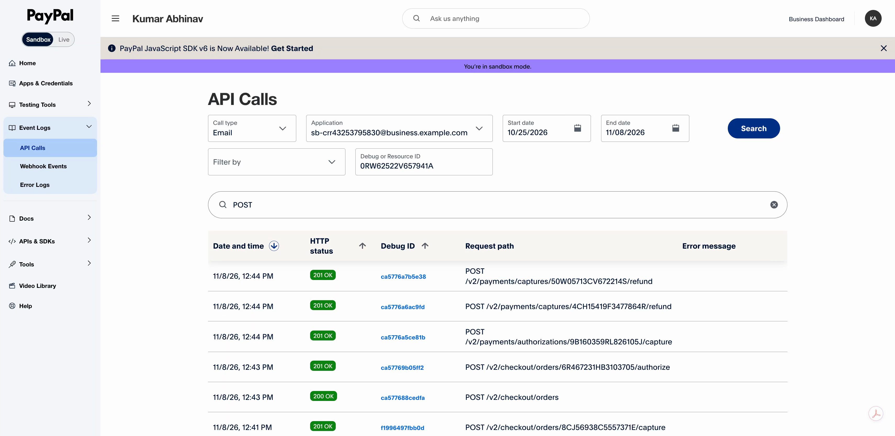

# PayPal's sandbox records

MakeRoom completed one account-backed sandbox booking on November 8, 2026. The demo video shows PayPal's own Developer dashboard under Event Logs > API Calls, with Sandbox selected.

These are the original operations, rather than only the later checks:

| Operation | PayPal request | HTTP status | PayPal debug ID |
| --- | --- | --- | --- |
| Authorize Maya's order | `POST /v2/checkout/orders/6R467231HB3103705/authorize` | 201 | `ca57769b05ff2` |
| Capture Maya's payment | `POST /v2/payments/authorizations/9B160359RL826105J/capture` | 201 | `ca5776a5ce81b` |
| Refund Alex's original payment | `POST /v2/payments/captures/4CH15419F3477864R/refund` | 201 | `ca5776a6ac9fd` |
| Refund Sam's original payment | `POST /v2/payments/captures/50W05713CV672214S/refund` | 201 | `ca5776a7b5e38` |

The video also opens both refund responses in PayPal's dashboard. Each has its own refund ID, the note "Thank you for moving your MakeRoom appointment." and a `COMPLETED` status. PayPal masks amounts in this dashboard, so the amounts below come from separate authenticated API readbacks.

| Result | PayPal ID | Amount | Readback status |
| --- | --- | --- | --- |
| Maya's capture | `0RW62522V6579041A` | USD 145.00 | `COMPLETED` |
| Alex's original capture | `4CH15419F3477864R` | USD 60.00 | `PARTIALLY_REFUNDED` |
| Sam's original capture | `50W05713CV672214S` | USD 60.00 | `PARTIALLY_REFUNDED` |
| Alex's refund | `17V66495EX001863A` | USD 15.00 | `COMPLETED` |
| Sam's refund | `6XF75371XW100903J` | USD 10.00 | `COMPLETED` |

[The later readback record](evidence/paypal-readback-2026-11-09.json) contains the GET endpoints, HTTP statuses and PayPal debug IDs from November 9, 2026 at 04:42 UTC. Every request returned HTTP 200. It excludes credentials and buyer details. The [public evidence page](https://abhinav0905.github.io/makeroom/?view=proof) retains the first readback from the completed run.

The customers and studio are fictional. One sandbox buyer represented all three customers. No live money moved. The public practice demo simulates payments; use the [local setup](../README.md) and your own PayPal sandbox accounts to run a new payment flow.
